# Campus-Scale IoT System: Portfolio & Implementation Evidence

> **Context Statement:**  
> *"During my undergraduate studies, I developed a campus-scale IoT system where floor gateways aggregated room telemetry and forwarded it to a digital-twin platform using Node-RED and ThingsBoard. I implemented TLS-secured MQTT and lightweight CoAP communication and simulated 200 smart rooms concurrently. This project introduced me to the challenges of building and maintaining reliable IoT deployments and motivated me to explore this area further."*

---

## Executive Summary & System Architecture

This project is a distributed, campus-scale Internet of Things (IoT) simulation and digital-twin management platform. The system coordinates **200 concurrent smart rooms** distributed across **10 building floors**, utilizing edge floor gateways, industrial-grade messaging protocols, cryptographic security, and a real-time digital-twin interface.

### Architectural Breakdown
- **Device & Room Simulation Layer (`campus_engine`)**: Simulates 200 rooms (20 rooms/floor): 100 rooms communicate via **mTLS MQTT (port 8883)** and 100 via **CoAP (UDP 5700–5899)**. Each room has a simple thermal model (drift toward the outdoor temperature via `alpha`, HVAC effect via `beta`), an HVAC actuator and a lighting dimmer. All rooms run concurrently in one Python asyncio process (403 tasks).
- **Edge Gateway Layer (`nodered_master` + 10x `nodered_floor` Gateways)**: 10 discrete Node-RED floor gateway containers aggregating local telemetry, computing floor averages, transforming formats, and routing actuation/RPC commands in both directions.
- **Message Broker (`mosquitto`)**: Hardened Eclipse Mosquitto broker enforcing **TLS v1.2** with X.509 client certificate authentication (mTLS) on port 8883, plain TCP on port 1883, and WebSockets on port 9001.
- **Digital-Twin Platform (`mytb` - ThingsBoard)**: PostgreSQL-backed ThingsBoard platform mapping the complete campus asset hierarchy (`Building-01` → `Floor-F01..F10` → `Room-R001..R200`), device relations, telemetry time-series, and floor plan heat maps.
- **Campus Control Dashboard (`campus_dashboard` - Streamlit)**: High-performance fleet management console monitoring average temperatures/humidity, real-time telemetry tables, and targeted fleet/room actuation.

---

## 1. ThingsBoard Digital-Twin Floor Plan Heat Map (Room Hover Evidence)

As requested, the digital twin includes an interactive SVG floor plan heat map with dynamic temperature color coding:
- **Blue (18–23 °C)**: below the 24 °C set-point
- **Orange (23–25 °C)**: around the set-point
- **Red (25–30 °C)**: above the set-point
- **Grey**: outside 18–30 °C or no data

When hovering over an individual room, a live telemetry tooltip exposes the entity name, live temperature, humidity, HVAC operational mode, last transmission timestamp, firmware version, and physics drift coefficients (`alpha`, `beta`).

### Live Heat Map with Active Room Hover Tooltip (Room 1)
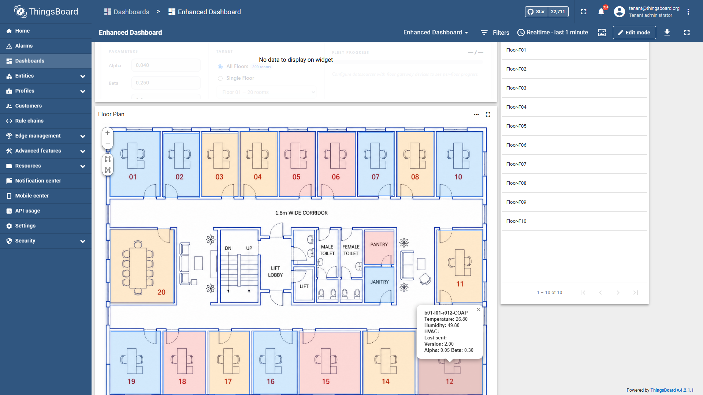

### Live Heat Map with Active Room Hover Tooltip (Room 3)
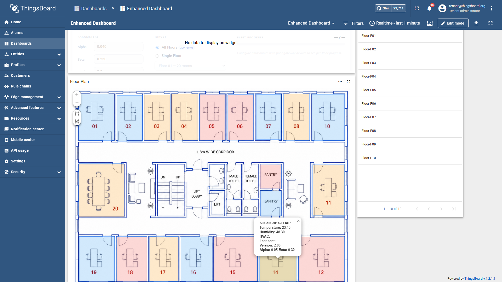

### Enhanced Digital-Twin Dashboard Overview
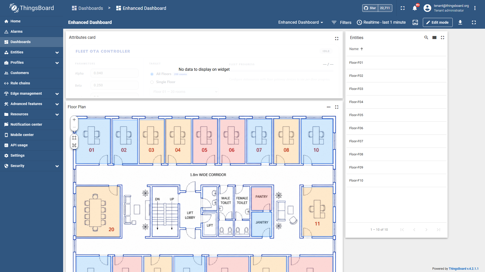

### Live Run: HVAC Switched On in Six Floor 1 Rooms (24 Nov 2026)
HVAC was switched ON for rooms 01, 04, 05, 08, 11 and 20 (three MQTT rooms, three CoAP rooms) from the Campus IoT Dashboard's *Targeted room control*, which publishes to the MQTT topic `campus/b01/cmd/<room>`. The floor plan was captured every 5 s for 5 minutes: the six rooms warmed from 20.1 °C to 23.6–24.0 °C and changed from blue to orange. All 73 screenshots, a timestamped version of each, and the ThingsBoard readings for every frame are in [`docs/evidence/floor1_hvac_run/`](./docs/evidence/floor1_hvac_run/). Times below are local time.

Before (07:10:25): all rooms at 20.1 °C, HVAC off:
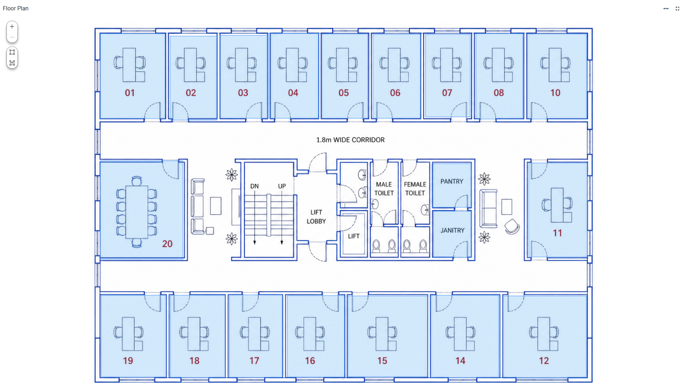

Command sent from the Campus IoT Dashboard (07:10:49):
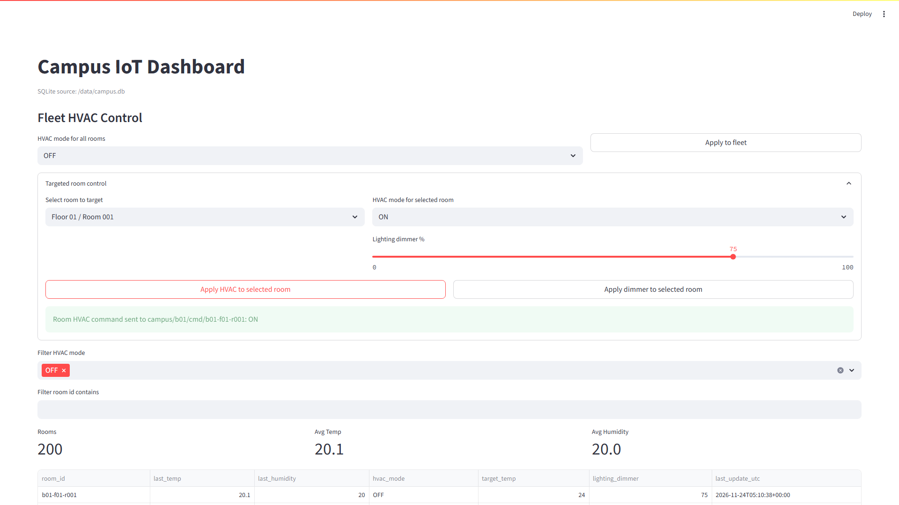

Five minutes later (07:15:49): the six rooms at 23.6–24.0 °C:
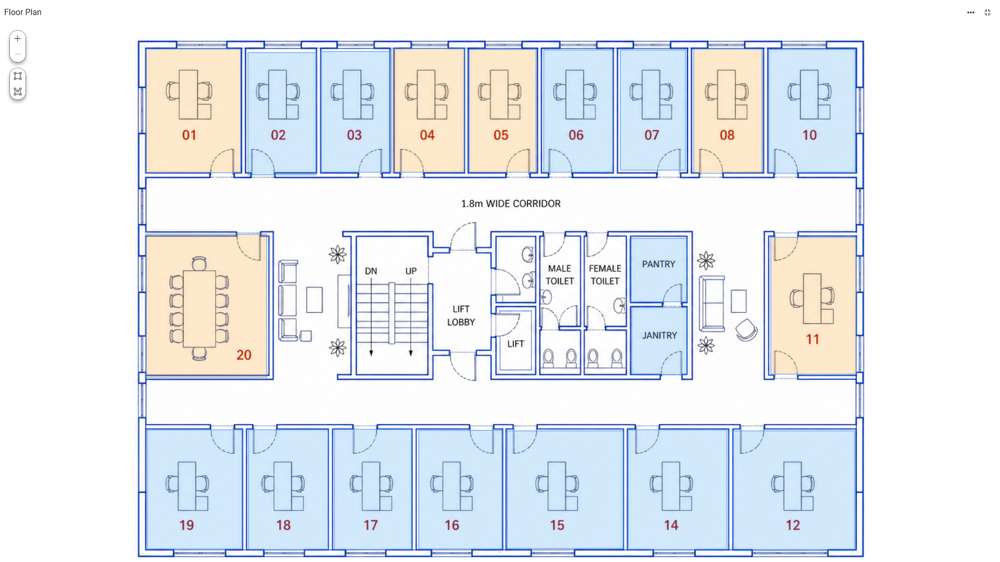

---

## 2. Simulation of 200 Smart Rooms Concurrently

The Python simulation engine runs 200 rooms concurrently (10 floors × 20 rooms; 100 MQTT rooms and 100 CoAP rooms). Every 5 s each room updates its temperature with a simple thermal model, and the engine saves all room states to SQLite every 30 s.

### Campus IoT Dashboard: Fleet Metrics & Real-time Aggregation
Shows all **200 rooms active**, live average temperature, average humidity, and fleet-wide HVAC mode commands:
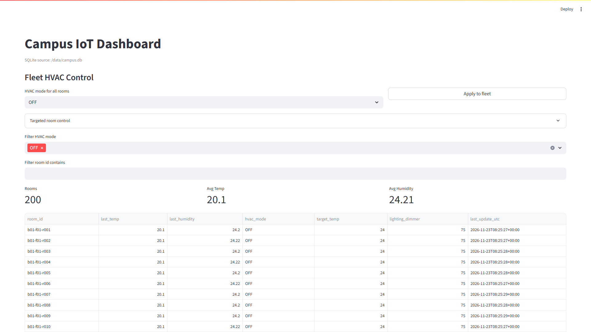

### Targeted Room Actuator Controls (HVAC & Light Dimmer)
Provides pinpoint actuation per room over MQTT command topics:
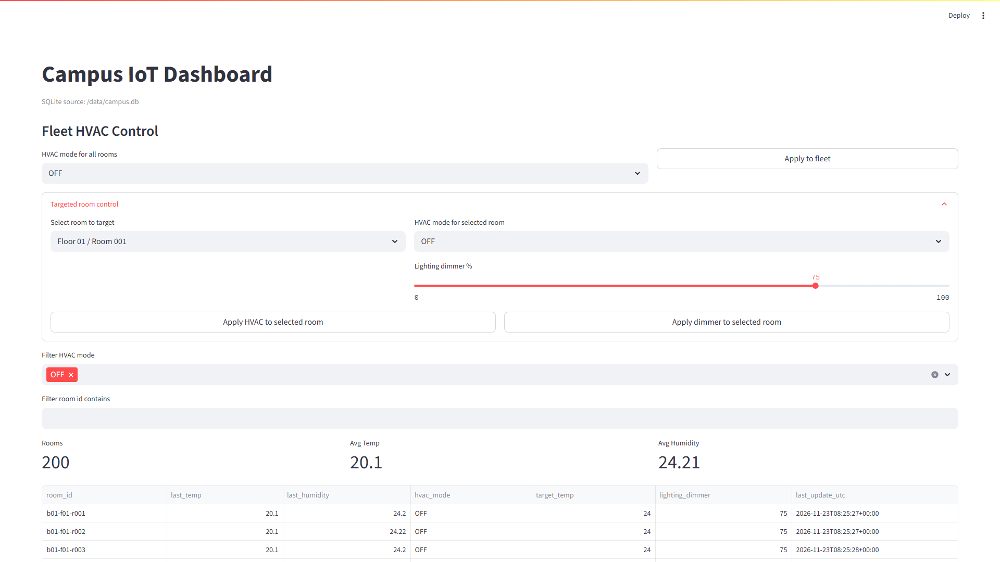

### Telemetry Table: All 200 Simulated Rooms (24 Nov 2026)
The dashboard's table in its full-screen view, listing every room from `b01-f01-r001` to `b01-f10-r200`:
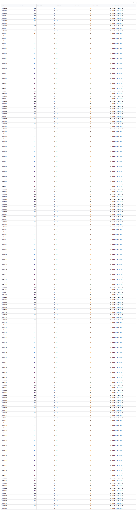

The same dashboard page at the same moment ("Rooms: 200"):
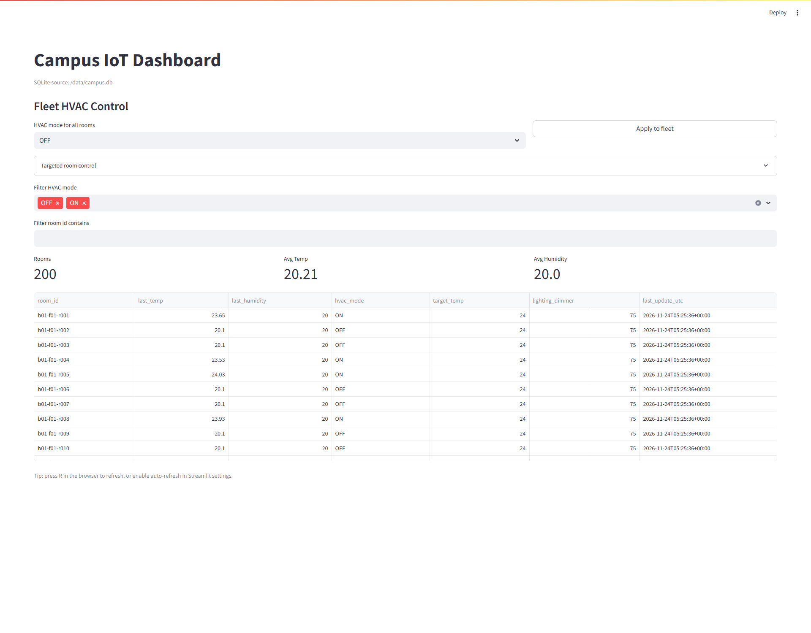

### Simulator Running Live (24 Nov 2026)
Unedited output of `docker ps` and of a read-only check run inside the `campus_engine` container ([`simulator_status_check.py`](./docs/evidence/simulator_status_check.py)):
- 200 rooms, all updated within the last 60 s.
- 100 CoAP room servers listening. Each listens on two addresses, so there are 200 sockets.
- 101 TLS connections to the MQTT broker: 100 MQTT rooms plus the engine's own client.

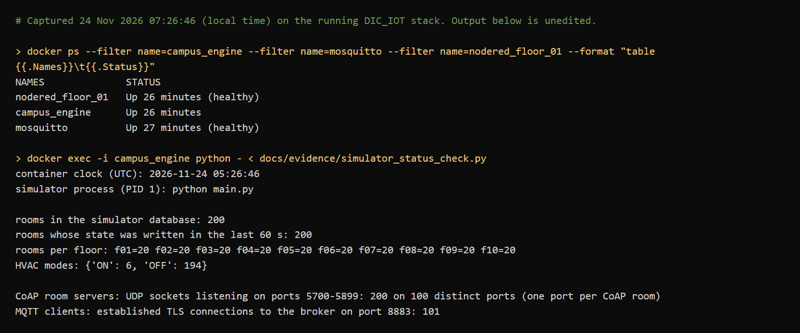

### Simulator Start-up Log (23 Nov 2026)
The engine log shows `booting campus sim — 200 nodes (10x20), paired MQTT+CoAP` and `403 tasks launched` (two tasks per room plus three engine tasks). The line "number of room CoAP servers started: 200" counts log lines: each of the 100 CoAP rooms starts a server on two addresses. Full log: [`campus_engine_full_log.txt`](./docs/evidence/campus_engine_full_log.txt).
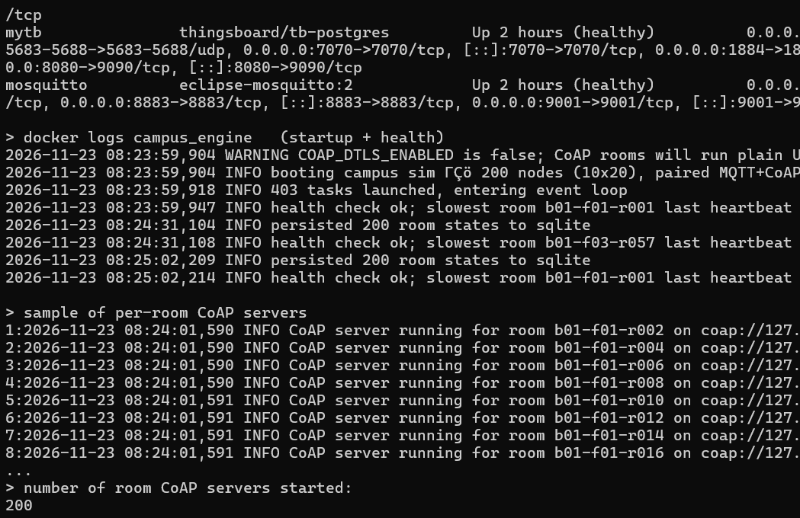

---

## 3. Floor Gateway Telemetry Aggregation (Node-RED)

Each floor utilizes a containerized Node-RED edge gateway (`nodered_floor_01` through `nodered_floor_10`) paired with a master orchestrator (`nodered_master`).

### Node-RED Master Flow: Floor Telemetry Aggregation & ThingsBoard Uplink
Aggregates incoming room telemetry via MQTT and CoAP sweepers, computes floor averages, and forwards the data to ThingsBoard via `v1/gateway/telemetry` and `v1/gateway/attributes`:
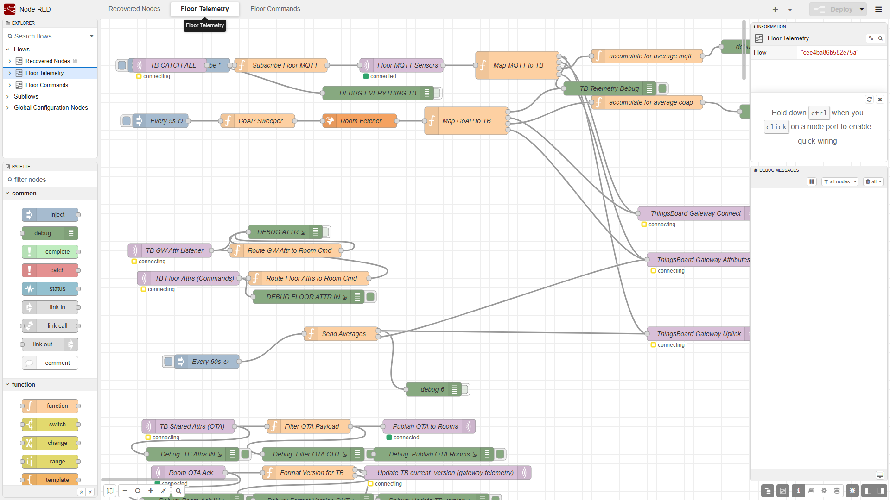

### Node-RED Master Flow: Floor Commands, RPC, and OTA Firmware Updates
Handles ThingsBoard RPC calls, converts cloud commands into local CoAP PUT requests and MQTT actuator topics, and listens for OTA acknowledgment packets:
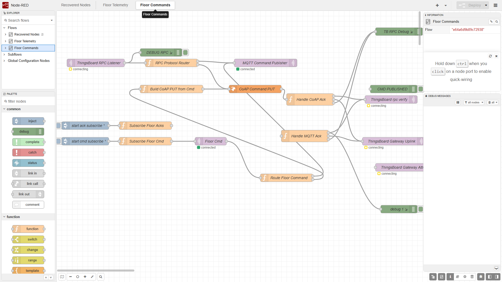

### Node-RED Floor 01 Dedicated Edge Gateway
Active edge gateway instance handling telemetry ingress for Floor 1:
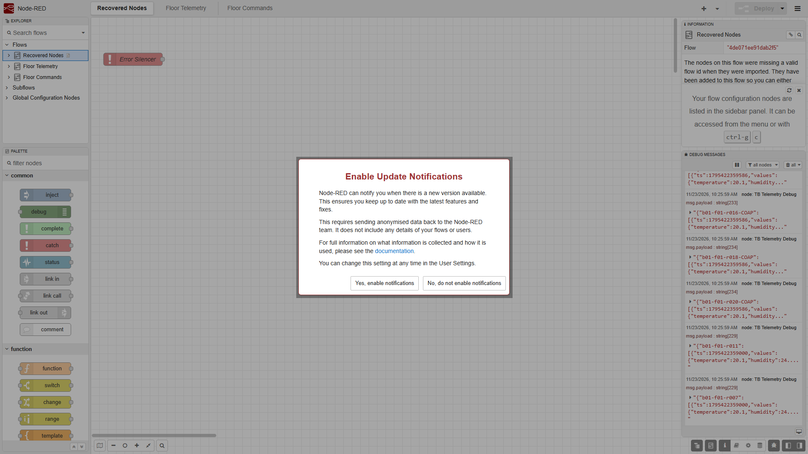

---

## 4. ThingsBoard Digital-Twin Platform Hierarchy & NOC Dashboard

### Digital-Twin Device Fleet
ThingsBoard's device list. Its total (612 devices) is not the number of rooms. About 220 devices are named after simulated rooms. About 370 more have room-style names that don't match their floor (e.g. `b01-f01-r101`); these extra devices were registered through the gateway API. The rest are gateway and demo devices. The asset hierarchy below holds exactly 200 rooms.
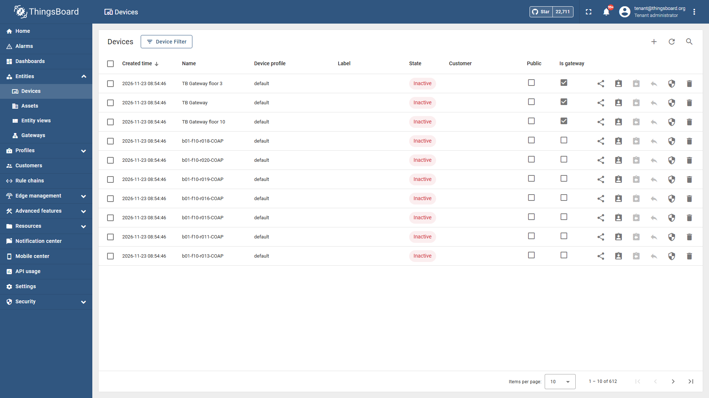

### Campus Asset Hierarchy (`Building` → `Floors` → `Rooms`)
1 building, 10 floors and 200 room assets (counted through the ThingsBoard API on 24 Nov 2026):
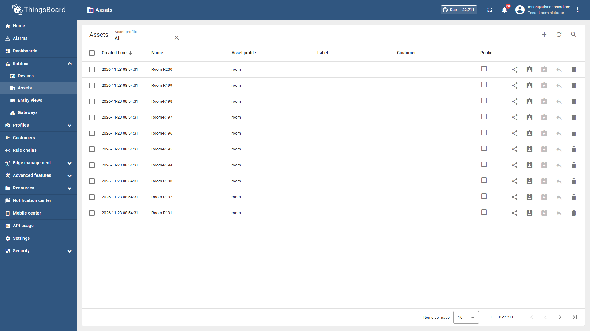

### Campus NOC Dashboard
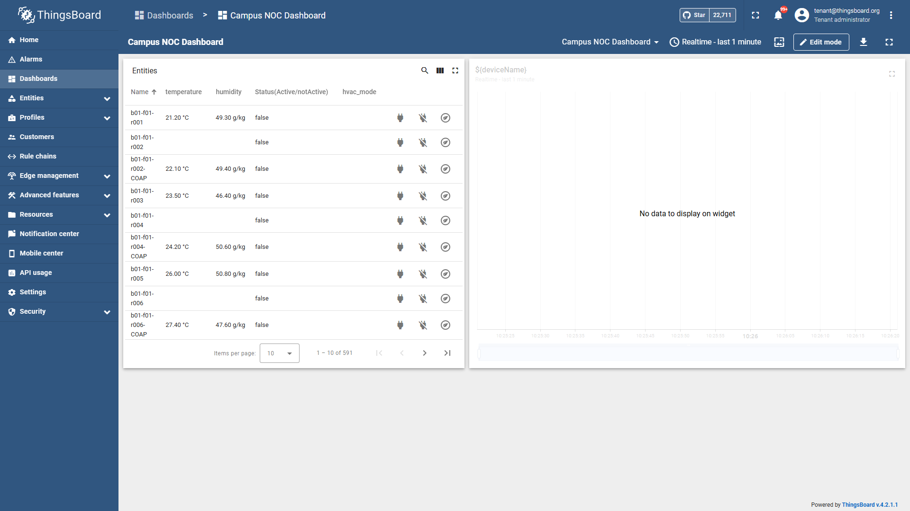

---

## 5. Security Architecture & Deployment Topology

### Cryptographic Security & Communication Protocols
- **mTLS MQTT Broker**: Eclipse Mosquitto on port `8883` requiring X.509 client certificates signed by `CampusIoT-CA`. Client Common Name (`CN=engine`) is mapped directly to ACL permissions (`use_identity_as_username true`).
- **CoAP Communication**: Lightweight UDP endpoints on ports `5700–5899`. DTLS with a pre-shared key (PSK) is implemented in the engine (`engine_app/core/coap_room.py`), but it was switched off (`COAP_DTLS_ENABLED=false`) in the runs captured here, so CoAP traffic was plain UDP.
- **Digital-Twin Uplink**: ThingsBoard's token-authenticated MQTT gateway API linking Node-RED to ThingsBoard.

### Active Container Landscape (15 Containers)
| Container Name | Service | Function | Network Port(s) | Health Status |
| :--- | :--- | :--- | :--- | :--- |
| `mosquitto` | Mosquitto 2.0 | TLS & TCP MQTT Broker | 1883, 8883 (TLS), 9001 (WS) | **Healthy** |
| `campus_engine` | Engine App | 200 Rooms Physics Simulator | 5700–5899/UDP | **Running** |
| `campus_dashboard`| Streamlit | Campus Management UI | 8501 | **Running** |
| `mytb` | ThingsBoard | Digital-Twin IoT Platform | 8080 (UI), 1884, 5683–5688/UDP | **Healthy** |
| `nodered_master` | Node-RED Master | Central Flow Coordinator | 1880 | **Healthy** |
| `nodered_floor_01`..`10` | 10x Floor Gateways | Edge Telemetry Aggregators | 1891–1900 | **Healthy** |

---

## 6. Known Limitations (as of 24 Nov 2026)
- **CoAP DTLS was off** in the captured runs (see section 5).
- **Target-temperature commands are not applied.** Node-RED builds `target_temp` commands but only sends them to a debug node, and the simulator reads only `hvac_mode`. Every room keeps its 24 °C set-point.
- **Extra devices in ThingsBoard**: see section 4.
- **Simple thermal model.** Rooms have no occupancy or random variation, so idle rooms all settle at the same temperature (20.1 °C). They differ only after a command.

---

*Screenshots captured from the running system on 23–24 Nov 2026.*
