# Campus-Scale IoT System (DIC_IOT)

A campus-scale IoT system: 200 simulated smart rooms on 10 floors report over MQTT and CoAP to Node-RED floor gateways. The gateways aggregate the data and forward it to a ThingsBoard digital twin with a live floor-plan heat map. Commands travel back down the same path.

Undergraduate team project (4 students).


<table>
  <tr>
    <td>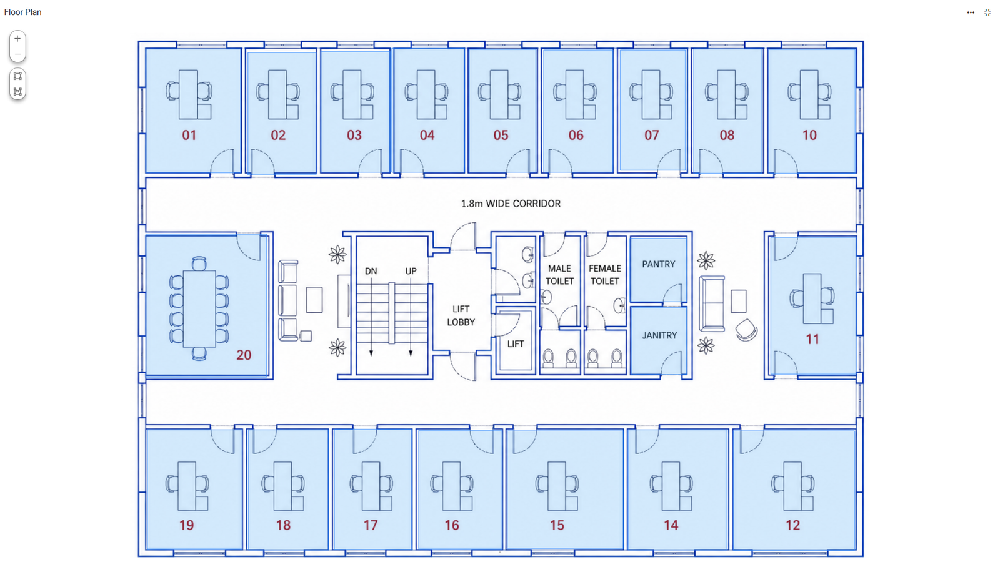</td>
    <td>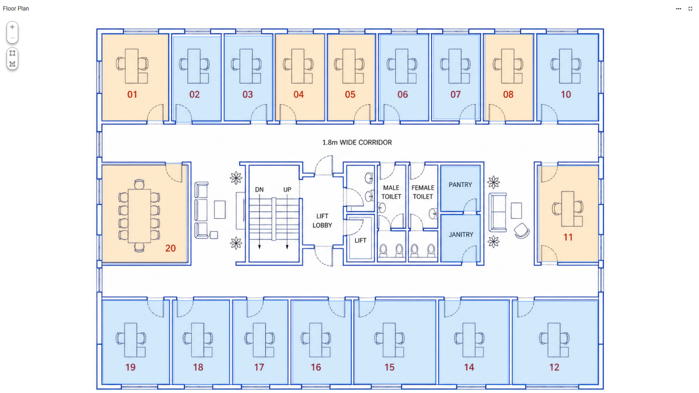</td>
  </tr>
  <tr>
    <td align="center"><sub>Floor 1, all rooms at 20 °C with HVAC off</sub></td>
    <td align="center"><sub>Five minutes after HVAC was switched on in six rooms: they warm to about 24 °C</sub></td>
  </tr>
</table>

## Contents

- [Highlights](#highlights)
- [Architecture](#architecture)
- [Screenshots](#screenshots)
- [Quick start](#quick-start)
- [Try it](#try-it)
- [Protocol reference](#protocol-reference)
- [Configuration](#configuration)
- [Repository layout](#repository-layout)
- [Known limitations](#known-limitations)
- [Operations](#operations)

## Highlights

- **200 rooms simulated concurrently** in one asyncio process: 100 rooms talk MQTT and 100 talk CoAP. Each room has a simple thermal model, an HVAC actuator (`ON` / `ECO` / `OFF`) and a lighting dimmer.
- **TLS-secured MQTT.** Mosquitto requires X.509 client certificates (TLS 1.2) on port 8883, with per-client ACLs.
- **Lightweight CoAP.** Each CoAP room runs its own CoAP server, and its resources support CoAP Observe. The gateways poll the rooms every 5 s and send commands with CoAP `PUT`.
- **Edge gateways.** 10 Node-RED floor gateways plus a master instance collect room data, compute floor averages, and forward everything through ThingsBoard's gateway API. They also route RPC commands and over-the-air configuration updates back to the rooms.
- **Digital twin.** ThingsBoard models the campus as `Building-01 → Floor-F01…F10 → Room-R001…R200`. Its interactive floor-plan heat map colours each room by its live temperature.
- **Control dashboard.** A Streamlit app for fleet-wide and per-room HVAC and dimmer control, with a live table of all 200 rooms.

## Architecture

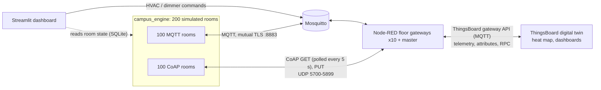

| Container | Role | Ports |
|---|---|---|
| `campus_engine` | Room simulator (Python asyncio, aiocoap, aiomqtt) | 5700–5899/udp (CoAP) |
| `mosquitto` | MQTT broker | 1883 (plain), 8883 (TLS with client certificates), 9001 (WebSockets) |
| `nodered_master` | Node-RED master; starts the floor gateways | 1880 |
| `nodered_floor_01` … `nodered_floor_10` | Node-RED floor gateways | 1891–1900 |
| `mytb` | ThingsBoard (PostgreSQL) | 8080 (UI), 1884 (MQTT), 5683–5688/udp (CoAP) |
| `campus_dashboard` | Streamlit control dashboard | 8501 |

## Screenshots

### Digital twin: live heat map

Each room on the floor plan is coloured by its latest temperature: blue 18–23 °C, orange 23–25 °C, red 25–30 °C. Hovering a room shows its live telemetry.

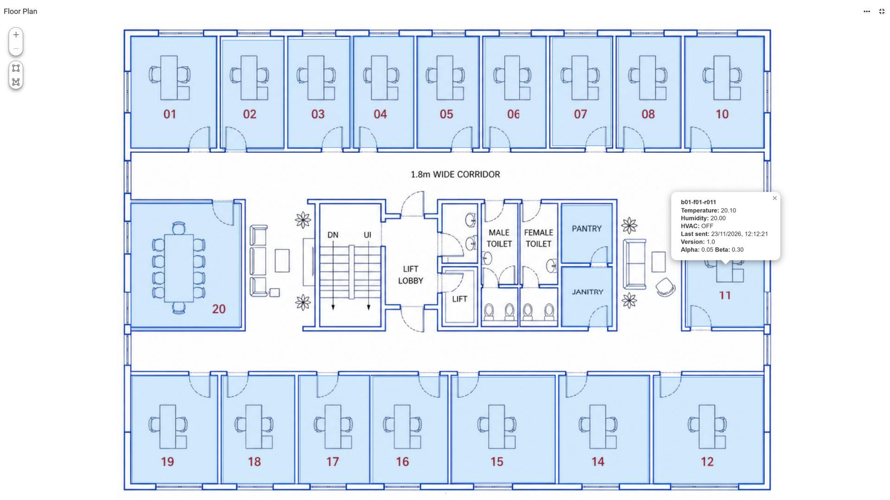

### Room devices in ThingsBoard

<table>
  <tr>
    <td width="50%">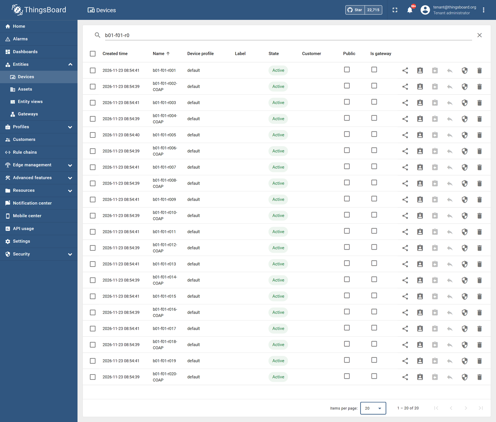</td>
    <td width="50%">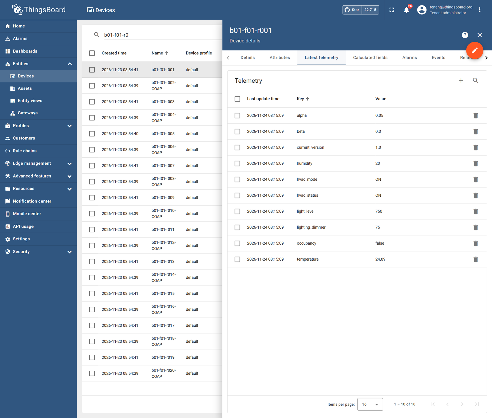</td>
  </tr>
  <tr>
    <td align="center"><sub>All 20 floor 1 room devices active (odd rooms MQTT, even rooms CoAP)</sub></td>
    <td align="center"><sub>Latest telemetry of one room device</sub></td>
  </tr>
</table>

<table>
  <tr>
    <td width="50%">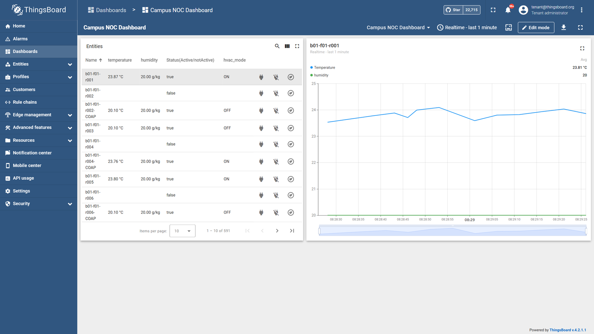</td>
    <td width="50%">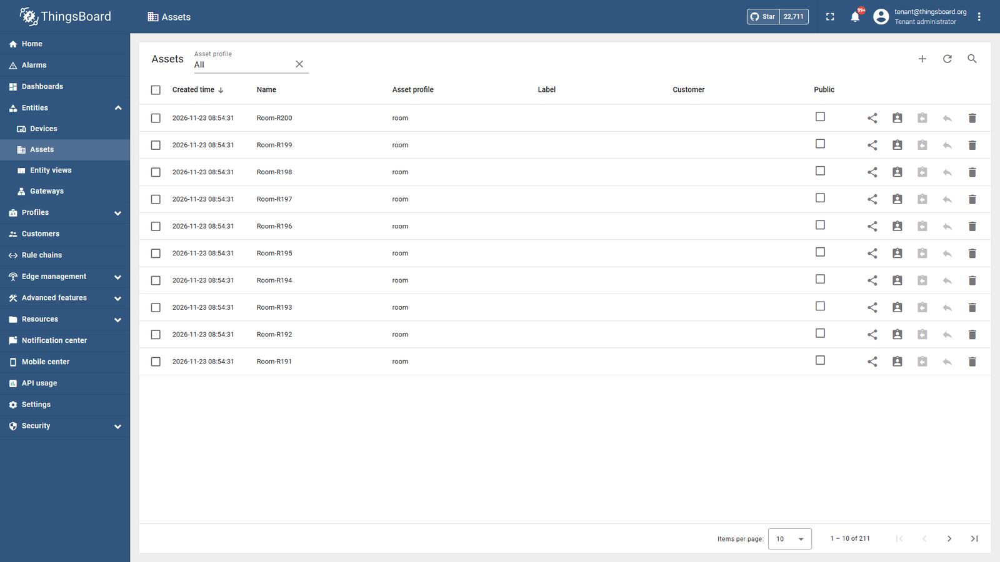</td>
  </tr>
  <tr>
    <td align="center"><sub>Campus NOC dashboard: device table and real-time chart</sub></td>
    <td align="center"><sub>Asset model: 1 building, 10 floors, 200 rooms</sub></td>
  </tr>
</table>

### Node-RED floor gateway

Telemetry flow: room data in over MQTT and CoAP, floor averages, uplink to ThingsBoard, and OTA updates.

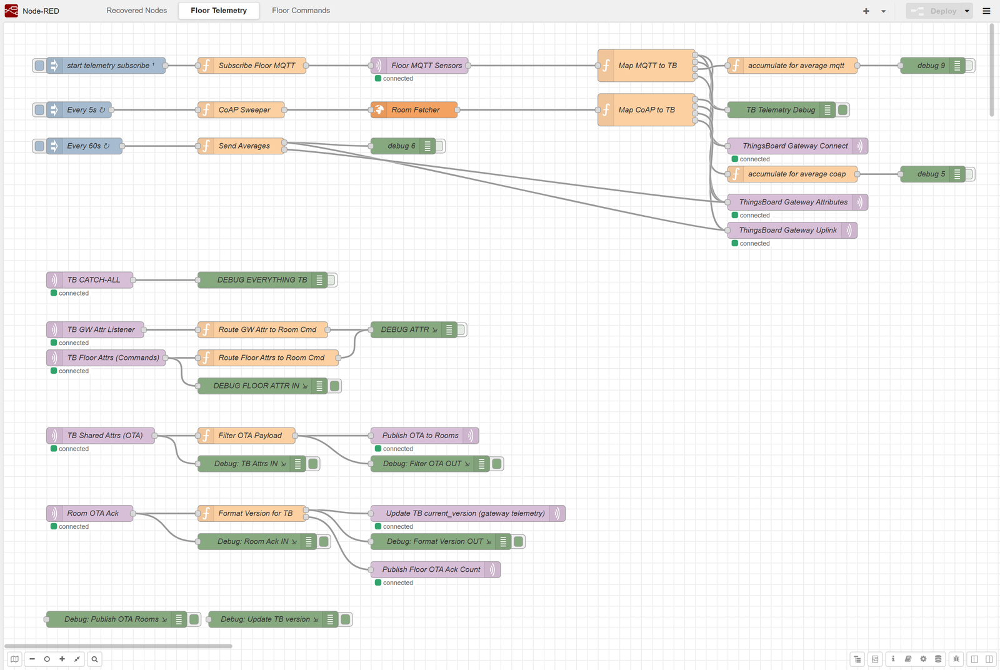

Command flow: ThingsBoard RPC → MQTT publish or CoAP `PUT` to the room → acknowledgement back to ThingsBoard.

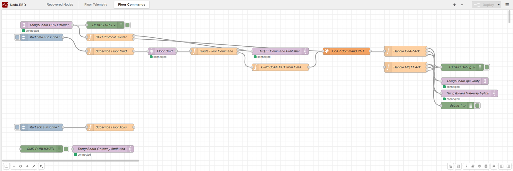

### Control dashboard (Streamlit)

<table>
  <tr>
    <td width="50%">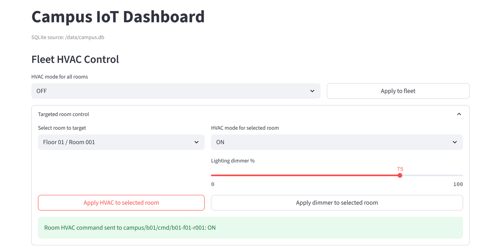</td>
    <td width="50%">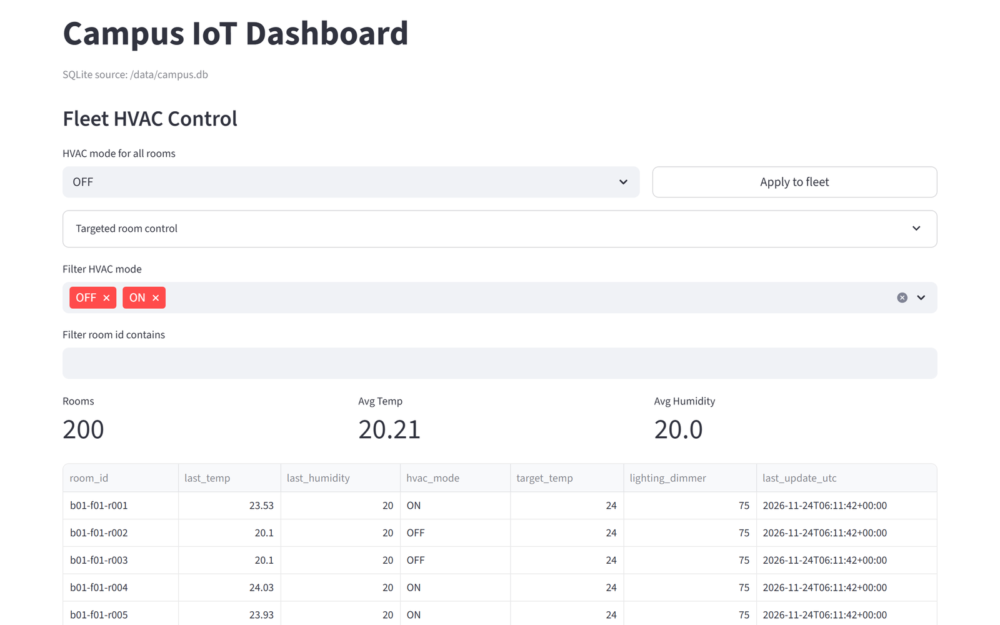</td>
  </tr>
  <tr>
    <td align="center"><sub>Sending an HVAC command to one room</sub></td>
    <td align="center"><sub>Fleet overview with all 200 rooms</sub></td>
  </tr>
</table>

More screenshots, including a five-minute capture of the HVAC run, are in [`docs/evidence/`](docs/evidence/).

## Quick start

Requirements: Docker Desktop (or Docker Engine with Compose).

```bash
cp .env.example .env      # then fill in the keys, passwords and tokens
docker compose up -d --build
```

`.env` is git-ignored, so keys, passwords and tokens stay out of the repo. TLS certificates for the broker and clients are in `certs/`. To create new ones, run `certs/generate_certs.sh`.

When the containers are up, open:

| Service | URL |
|---|---|
| Streamlit dashboard | http://localhost:8501 |
| ThingsBoard | http://localhost:8080 (ThingsBoard's default demo tenant: `tenant@thingsboard.org` / `tenant`) |
| Node-RED master | http://localhost:1880 |
| Node-RED floor gateway N | http://localhost:1891 … http://localhost:1900 |

ThingsBoard takes 1–2 minutes to start. Telemetry appears once the gateways connect.

## Try it

Watch floor 1 telemetry through the broker's plain listener:

```bash
docker exec mosquitto mosquitto_sub -h localhost -p 1883 -t "campus/b01/f01/#" -v
```

Switch on HVAC in one room (modes: `ON`, `ECO`, `OFF`):

```bash
docker exec mosquitto mosquitto_pub -h localhost -p 1883 \
  -t "campus/b01/cmd/b01-f01-r001" -m '{"hvac_mode":"ON"}'
```

Watch the room warm up on the ThingsBoard floor plan (**Dashboards → Enhanced Dashboard**). You can do the same from the Streamlit dashboard's *Targeted room control* panel.

Check the simulator from inside its container:

```bash
docker exec -i campus_engine python - < docs/evidence/simulator_status_check.py
```

This prints the number of rooms, how many updated in the last minute, the CoAP servers listening and the MQTT connections to the broker.

## Protocol reference

### MQTT topics

Room IDs look like `b01-f01-r001`. A room's base topic is `campus/b01/fFF/rRRR`.

| Topic | Direction | Payload / purpose |
|---|---|---|
| `campus/b01/fFF/rRRR/telemetry` | room → broker | Full room payload (temperature, humidity, occupancy, light, HVAC mode, dimmer, version) |
| `campus/b01/fFF/rRRR/sensor/{temperature,humidity,occupancy,light}` | room → broker | Single sensor readings |
| `campus/b01/health` | room → broker | Heartbeat `{room_id, ts}` |
| `campus/b01/fFF/rRRR/lwt` | broker | Last will when a room disconnects |
| `campus/b01/cmd/b01-fFF-rRRR` | → room | `{"hvac_mode": "ON"\|"ECO"\|"OFF"}` for one room (forwarded to CoAP rooms by the engine) |
| `campus/b01/actuator/hvac` | → all rooms | Fleet HVAC command |
| `campus/b01/fFF/rRRR/actuator/light_dimmer` | → room | `{"lighting_dimmer": 0-100}` |
| `campus/b01/fFF/rRRR/ack/{hvac_applied,light_dimmer_applied}` | room → broker | Command acknowledgements |
| `campus/b01/ota/config`, `campus/b01/ota/ack` | both | Over-the-air configuration (checked with a SHA-256 hash) and its acknowledgements |

### CoAP resources

Each CoAP room listens on UDP port `5700 + room_number − 1`, for example room 002 on port 5701.

| Resource | Method | Purpose |
|---|---|---|
| `/payload` | GET, observe | Full room payload |
| `/sensor/{temperature,humidity,occupancy,light}` | GET, observe | Single sensor readings |
| `/health` | GET, observe | Heartbeat |
| `/actuator/hvac` | PUT (JSON) | `{"hvac_mode": "ON"\|"ECO"\|"OFF"}` |
| `/actuator/light_dimmer` | PUT (JSON) | `{"lighting_dimmer": 0-100}` |

## Configuration

Settings live in `.env`.

| Variable | Default | Purpose |
|---|---|---|
| `NUM_FLOORS` / `ROOMS_PER_FLOOR` | `10` / `20` | Campus size |
| `ALPHA` / `BETA` | `0.05` / `0.3` | Drift toward outdoor temperature / HVAC effect per tick |
| `OUTSIDE_TEMP` | `20.0` | Outdoor temperature (°C) |
| `DEFAULT_TARGET_TEMP` | `24.0` | Room set-point (°C) |
| `PUBLISH_INTERVAL` | `5` | Seconds per simulation tick |
| `HEALTH_INTERVAL` | `30` | Seconds between engine health checks |
| `MQTT_HOST` / `MQTT_PORT` | `mosquitto` / `8883` | Broker address (TLS port) |
| `MQTT_CA_CERT`, `MQTT_CLIENT_CERT`, `MQTT_CLIENT_KEY` | `/certs/ca.crt`, `/certs/engine.crt`, `/certs/engine.key` | Client certificate files for mutual TLS |
| `COAP_DTLS_ENABLED` | `False` | Turn on DTLS (pre-shared key) for the CoAP rooms |
| `DTLS_PSK_IDENTITY` | `campus-iot-sensor` | DTLS PSK identity |
| `LOG_LEVEL` | `INFO` | Engine log level |
| `DTLS_PSK_KEY_B64` | *(secret)* | DTLS pre-shared key, from `certs/generate_certs.sh` |
| `MQTT_USER` / `MQTT_PASS` | `engine` / *(secret)* | Broker service account |
| `TB_ACCESS_TOKEN` | *(secret)* | ThingsBoard token of the Node-RED master's own device |
| `GATEWAY_TOKEN` | *(secret)* | ThingsBoard gateway tokens, one per floor, comma-separated |

## Repository layout

```text
engine_app/       Room simulator: MQTT and CoAP rooms, thermal model, SQLite state
dashboard_app/    Streamlit control dashboard
node-red/         Node-RED flows shared by the master and the floor gateways
mosquitto/        Broker config and ACL
certs/            CA, broker and client certificates (generate_certs.sh)
thingsboard/      Rule chain template and ThingsBoard logging config
Wokwi/            ESP32 MicroPython prototype of a single room node (Wokwi simulator);
                  copy secrets.example.py to secrets.py for the HiveMQ login
docs/             Screenshots and evidence captures
*.py (root)       ThingsBoard provisioning and capture scripts
```

## Known limitations

- CoAP DTLS is implemented in the engine but switched off by default (`COAP_DTLS_ENABLED=False`), so CoAP traffic is plain UDP.
- Target-temperature commands are not applied. Node-RED builds `target_temp` commands, but they only reach a debug node, and the engine reads only `hvac_mode`. Every room keeps the 24 °C set-point.
- ThingsBoard holds more room devices than there are rooms. Besides the 200 real room devices, the gateways have registered extra room-named devices (for example `b01-f01-r101`). Filter the device list by **State: Active** to see the live ones.
- The thermal model is deliberately simple: no occupancy or random variation, so idle rooms all settle at the same temperature.

## Operations

<details>
<summary><b>Floor average temperature in the ThingsBoard rule engine (template)</b></summary>

The Node-RED gateways already compute floor averages. If you'd rather compute them in ThingsBoard's rule engine, start from the template in [`thingsboard/rulechains/`](thingsboard/rulechains/). Adjust the node types if your ThingsBoard version differs.

Recommended nodes:

1. **Message Type Switch**: pass `POST_TELEMETRY_REQUEST` only.
2. **Relation Query**: find the parent floor asset from the room using the `Contains` relation (direction TO if the relation is Floor → Room).
3. **Aggregate Latest**: aggregate the key `temperature` across all rooms related to the floor.
4. **Script**: map the aggregate output to floor telemetry.
5. **Save Timeseries**: save the telemetry to the floor asset.

Script node example (expects `msg.avg` from the Aggregate Latest node):

```javascript
var avgTemp = msg.avg !== undefined ? msg.avg : null;
if (avgTemp === null) {
  return null;
}

msg = {
  floor_avg_temperature: avgTemp,
  floor_avg_sample_count: msg.count || 0
};
return { msg: msg, metadata: metadata, msgType: 'POST_TELEMETRY_REQUEST' };
```

</details>

<details>
<summary><b>ThingsBoard disk growth: safe cleanup</b></summary>

When a ThingsBoard restore suddenly uses several GB, the growth is usually in PostgreSQL data on the Docker volume behind `/data/db`, especially `/data/db/base` and `/data/db/pg_wal`. Don't delete files from `pg_wal` by hand; PostgreSQL manages that directory itself.

1. Inspect usage first:

   ```bash
   docker system df -v
   docker ps -a --size
   docker exec mytb sh -c "du -sh /data/db/base /data/db/pg_wal /var/log/thingsboard 2>/dev/null"
   ```

2. Stop writes into ThingsBoard before cleanup:

   ```bash
   docker compose stop nodered_master engine
   ```

3. Ask PostgreSQL to flush the WAL:

   ```bash
   docker exec mytb psql -U postgres -d thingsboard -c "CHECKPOINT;"
   ```

4. If `pg_wal` stays large after a restore, restart ThingsBoard cleanly:

   ```bash
   docker compose restart mytb
   ```

5. Remove the Docker build cache when you no longer need cached image layers:

   ```bash
   docker builder prune -a
   ```

6. Remove unused Docker resources only if you're sure they are disposable:

   ```bash
   docker system prune
   docker volume prune
   ```

7. Remove old restore volumes only after confirming they aren't needed:

   ```bash
   docker volume ls
   docker volume rm <old_tb_volume_name>
   ```

</details>

<details>
<summary><b>Restoring ThingsBoard into a fresh volume</b></summary>

You can override the ThingsBoard volume names with `TB_DATA_VOLUME` and `TB_LOGS_VOLUME`. That lets you restore into a new volume each time instead of growing the long-lived database.

Start ThingsBoard on a fresh restore volume:

```powershell
# PowerShell
$env:TB_DATA_VOLUME="dic_iot_mytb_restore_20260509"
$env:TB_LOGS_VOLUME="dic_iot_mytb_restore_20260509_logs"
docker compose up -d mytb
```

```bash
# Bash
TB_DATA_VOLUME=dic_iot_mytb_restore_20260509 \
TB_LOGS_VOLUME=dic_iot_mytb_restore_20260509_logs \
docker compose up -d mytb
```

Run the restore inside that instance, then start the rest of the stack (`docker compose up -d`) from the same shell. While the two variables stay set, the stack keeps using the restored data.

To roll back to the original volumes (`dic_iot_mytb_data`, `dic_iot_mytb_logs`), stop the stack, clear the variables and start again:

```powershell
# PowerShell
docker compose down
Remove-Item Env:TB_DATA_VOLUME -ErrorAction SilentlyContinue
Remove-Item Env:TB_LOGS_VOLUME -ErrorAction SilentlyContinue
docker compose up -d mytb
```

```bash
# Bash
docker compose down
unset TB_DATA_VOLUME TB_LOGS_VOLUME
docker compose up -d mytb
```

</details>
